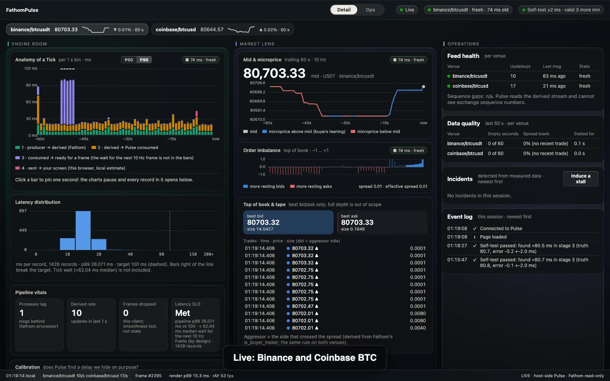
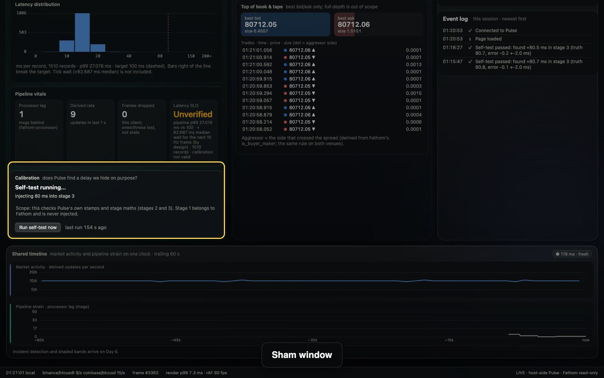
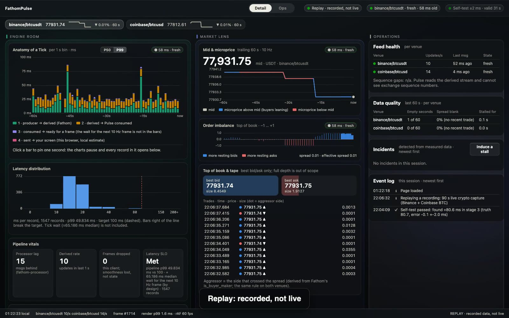

# FathomPulse

**A live dashboard on [Fathom](https://github.com/DevOGhere)'s market-data pipeline that measures its own truthfulness.**

Two lenses on one timeline: **market microstructure** (mid, microprice, order-book imbalance, top of book, trades) and the **engine room** (where each update spent its time, processor lag, incidents). Built on Fathom's live Kafka stream (Binance + Coinbase, BTC).



**[Watch the 3 minute walkthrough](https://ojaswishere.in/fathompulse/demo.mp4)**, recorded from the running app.

| Self-test hides a known delay | An induced stall, labelled as induced |
|---|---|
|  |  |

## What is different: Honest Glass

1. **Every number carries its age.** Data-age chips on every panel; the *Anatomy of a Tick* waterfall splits an update's life into measured stages (producer → derived → Pulse consumed → ready for a frame). Stamps are host-side monotonic; nothing is estimated unless it says so.
2. **It tests itself.** Every few minutes Pulse injects a known delay (80 ms) at a real stamp site of one of its own stages, and checks that the waterfall finds the right stage and size. The badge shows *Self-test ±N ms, valid for M min*, *inconclusive* (the system was not steady) or *failed*. A sham window first proves the test does not cry wolf. Scope: it checks Pulse's own stages (consumer and aggregator), not Fathom's stamps, exchange clocks or network transit.
3. **It says when the feed is gone.** An outage reads as a growing "last update N s ago", never as "no data yet". Incidents (stall, rate collapse, processor lag) are detected from measured data, shaded on the timeline, and explained with a cause that only claims what Pulse can see.
4. **Two views on one slider.** *Detail* shows every measurement at 10 Hz; *Ops* turns the same data into calm, categorical status (Fresh / Smooth / Keeping up, with hysteresis so labels do not flicker).
5. **It can replay a recording** through the same code path as live data, deterministically (two cold browsers produce byte-identical renders).

## Run it

Pulse runs **host-side** next to Fathom's producer/processor (monotonic stamps are only comparable on one kernel). Fathom is read-only from here.

```
# Fathom infra (docker compose: redpanda, clickhouse, ...) up; then, from the fathom repo, host-side.
# ORDER MATTERS: processor first, then producer. Coinbase sends its book snapshot once, when the producer subscribes; a processor
# that starts later drops every delta ("GAP ... delta before snapshot") and Coinbase stays silent until the producer is restarted.
( set -a; . ./.env; FETCH_WAIT_MAX_MS=10 FLUSH_SECONDS=0.02 COMMIT_ASYNC=1 PIPELINED_FLUSH=1 POLL_TIMEOUT_S=0.02 CH_ASYNC_INSERT=1 \
  .venv/bin/python -m processor.consumer )       # derived features; the six knobs are Fathom's sealed-benchmark config (see "What this is not")
.venv/bin/python -m producer.producer            # live feeds -> Kafka
# from this repo:
python3 -m venv .venv && .venv/bin/pip install -r requirements.txt
.venv/bin/python -m pulse.api                    # http://127.0.0.1:8765/
```

## Interfaces

| | |
|---|---|
| `WS /stream` | 10 Hz, each frame a self-contained snapshot of the trailing 1 s (no deltas). Drop-oldest per-client queue; the drop count is in the frame. |
| `GET /features/latest`, `/features/window` | **pulse.fv.1**: closed 1 s bins as feature vectors, frozen field list, provenance block. Ring only (5 min). The model that would consume it lives elsewhere (FathomFlow). |
| `GET /incidents`, `POST /incident/induce` | detector output; the induced stall is the demo. |
| `GET /calibration`, `POST /calibrate` | self-test state; run one now. |
| `/?replay=<capture.ndjson>` | replay a recording made with `tools/capture.py`. |

## Gates (what "works" means here; all runnable)

```
.venv/bin/python -m pytest -q                              # 71 unit/contract tests (incl. the node-run Ops logic)
.venv/bin/python -m pulse.api.soak --seconds 120           # frame cadence, drops, backpressure
.venv/bin/python -m pulse.api.calib_gate --runs 10         # calibration finds the injected delay (live)
.venv/bin/python -m pulse.api.incident_gate --runs 3       # induced stall is detected, labelled, cleared (live)
.venv/bin/python tools/replay_check.py <scratch> /static/captures/<name>.ndjson   # replay determinism, 2 cold browsers
.venv/bin/python tools/sane_check.py                       # cross-check against Fathom's Prometheus (read-only)
.venv/bin/python tools/chaos.py 8                           # a REAL 8 s processor stall (SIGSTOP/SIGCONT): the detector must say processor side and open lag_spike
```

## What this is not

- **Not a microsecond system.** Python, a Kafka hop and a 10 Hz frame cadence make it ms-class by design; it is an observability layer, not a trading hot path. The 10 Hz tick wait (up to 100 ms) is reported separately from the pipeline SLO.
- **Fathom's own latency depends on its processor flags.** Default flags: ~0.5 s tick-to-store (the sealed ladder's baseline: P50 517 ms, P99 3.7 s). With the six sealed knobs above, a 45-minute live soak on this rig measured **P50 7.9 ms / P99 48.3 ms** (26,934 samples, Prometheus histogram buckets, so coarse). That soak ran on Binance only (Coinbase was down from the start-order issue above) and one minute was inflated by a browser recording on the same CPU. Fathom's sealed run was P50 20.4 / P99 63.4 ms over one hour with both feeds: same range, not a like-for-like comparison. At 3000 msg/s Fathom saturates; live crypto is ~25 msg/s. Pulse's own numbers measure from the point Pulse sees a record.
- Not tested against exchange-side causes; the detector never names a culprit it cannot see.
- **Hardened for localhost, not authenticated.** Cross-origin POSTs are refused (a web page on another site cannot trigger the stall demo), `PULSE_PUBLIC=1` removes `/debug/stats`, `/incident/induce` and `/calibrate`, `/stream` caps clients (`PULSE_MAX_CLIENTS`, default 10) and the baseline security headers are set. There is no login; do not expose it to a network. Only crypto captures are meant to be published.

See `docs/DESIGN.md` for the decisions and `docs/METRICS.md` for every definition and caveat.
